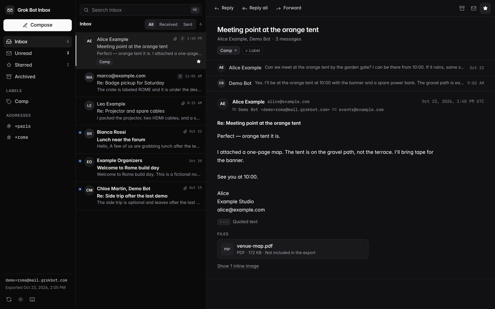
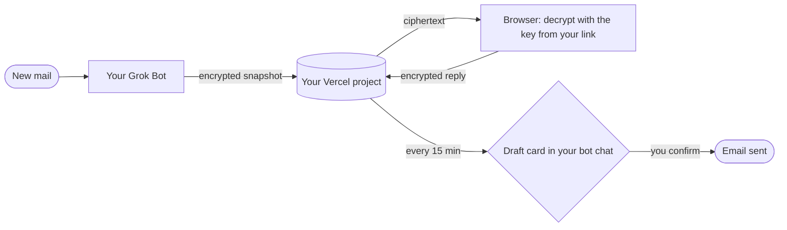
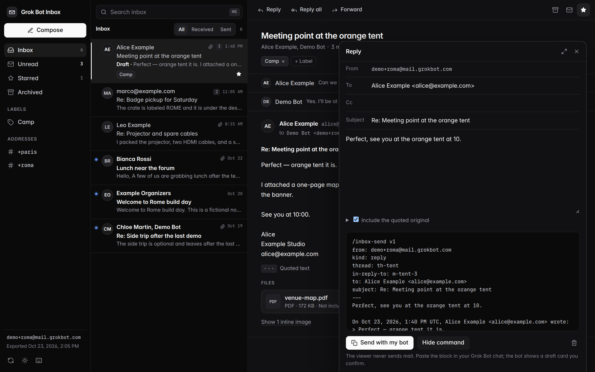
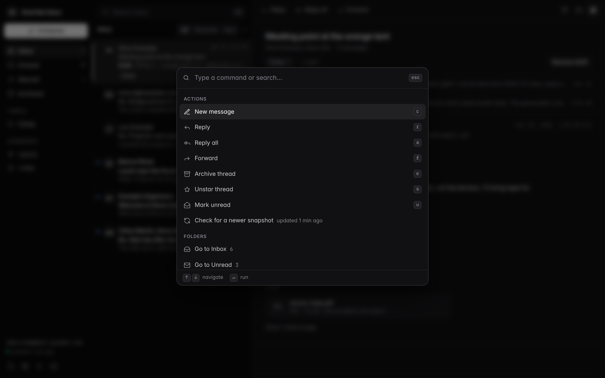
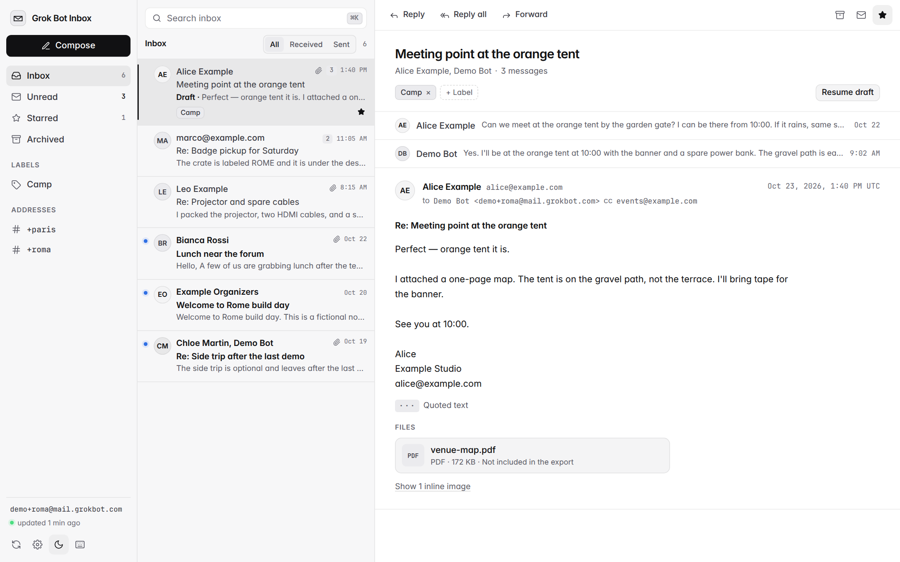
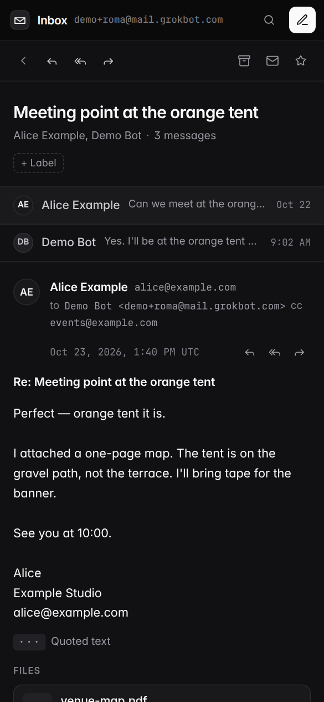

<div align="center">


# Grok Bot Inbox

**A real inbox for the mail your Grok Bot receives. Private, free, and hosted by you.**

[](https://grokbot-inbox-mascarock.vercel.app/demo)
[](BOT_TEMPLATE_LINK)
[](https://vercel.com/new/clone?repository-url=https://github.com/mascarock/grokbot-inbox&project-name=grokbot-inbox)



[](https://github.com/mascarock/grokbot-inbox/actions/workflows/pages.yml) [](LICENSE)

</div>

## Why

- **Private.** Your mail is encrypted before it leaves your bot and decrypted only in your browser. The page that hosts it sees ciphertext.
- **Free.** A free Vercel project and the Grok Bot you already have. No account here, no subscription, no central server.
- **Yours.** Your own copy at `grokbot-inbox-<you>.vercel.app`, your own key, your own bot doing the sending. Delete it any time.

## How it works

1. **Import the bot template** (button above) and tell your bot *show me my inbox*. The first time, it asks you to connect Vercel (one click) and publishes your copy of this viewer.
2. **Open the link** your bot gives you once. Your inbox appears and keeps itself up to date: every time new mail arrives, your bot publishes a fresh encrypted snapshot.
3. **Reply from the inbox.** *Send with my bot* leaves an encrypted draft for your bot; within about 15 minutes it shows you a draft card and sends only after you confirm. Replies work right away, nothing to configure.



Your link is `https://grokbot-inbox-<you>.vercel.app/#k=<key>`: the key after `#` never reaches a server and is kept on your device. Replies are encrypted with the same key, so your project only ever stores ciphertext in both directions. Want replies delivered instantly? Add a webhook in Settings (optional). Details: [docs/RELAY.md](docs/RELAY.md).

## Features

| | |
| --- | --- |
| **Live** | New mail shows up by itself; "updated 2 min ago" in the corner |
| **Reply, reply all, forward** | Recipients prefilled, quoted original folded, drafts autosaved |
| **Send with my bot** | One click, nothing to set up; your bot shows a draft card before anything goes out |
| **Star, archive, label** | Plus read/unread and search, kept in your browser |
| **Command palette** | `⌘K` for actions, folders, labels, addresses, threads |
| **Keyboard first** | `j` `k` `r` `e` and friends, see [docs/SHORTCUTS.md](docs/SHORTCUTS.md) |
| **Safe HTML mail** | Sanitized, sandboxed, remote images blocked until you say so |
| **Phone friendly** | List, thread, compose: one screen at a time, dark or light |

<details>
<summary>More screenshots</summary>

</details>

## Privacy

- Mail is **AES-256-GCM encrypted** by your bot; the key travels only in the `#` part of your link and stays on your device.
- Your Vercel project serves **ciphertext and a static page**, and stores your replies as **ciphertext** until your bot picks them up. There is no server of ours anywhere.
- Stars, labels, drafts, and settings live in **your browser only**.
- The viewer **cannot send mail**. Every reply ends at your bot's draft card, which you confirm.

Details in [docs/PRIVACY.md](docs/PRIVACY.md).

## Self-host

Your bot does the deploying. By hand: the *Deploy your own* button clones this repository into your Vercel account, and a prebuilt [`dist.tar.gz`](https://github.com/mascarock/grokbot-inbox/releases/latest) is published on every push to `main`.

<details>
<summary>Run locally, GitHub Pages, bot builder docs</summary>

```sh
npm install && npm run dev        # http://localhost:5173/?demo
npm test && npm run lint && npm run build
```

[`pages.yml`](.github/workflows/pages.yml) can publish to GitHub Pages: enable Pages (Source: GitHub Actions), set the repository variable `ENABLE_PAGES=true`, and `VITE_BASE_PATH` for a project site. Pages has no functions, so the outbox and the webhook relay are Vercel only.

| Doc | Covers |
| --- | --- |
| [bot/SKILL.md](bot/SKILL.md) | The Grok Bot skill: deploy, export read-only, publish encrypted snapshots on new mail, pick up replies from the encrypted outbox every 15 minutes, confirm every send |
| [docs/RELAY.md](docs/RELAY.md) | Snapshot format, auto-publish flow, payloads, the encrypted outbox (`/api/outbox`), the optional webhook and `/api/relay`; scripts [bot/encrypt_inbox.mjs](bot/encrypt_inbox.mjs), [bot/outbox.mjs](bot/outbox.mjs) |
| [docs/SCHEMA.md](docs/SCHEMA.md) | Export format and [schema/inbox.schema.json](schema/inbox.schema.json) |
| [docs/LINK.md](docs/LINK.md) · [docs/COMMANDS.md](docs/COMMANDS.md) | Fallback `#data=` links ([tools/make_link.py](tools/make_link.py)) and paste-able `/inbox-send` commands |

Roadmap: [docs/ROADMAP.md](docs/ROADMAP.md).

</details>

## Contributing

Issues and pull requests welcome. Keep it static plus two small functions, keep plaintext mail out of every server except the owner's bot, and run `npm test && npm run lint && npm run build` before pushing. Never commit a real export.

## License

[MIT](LICENSE) © Niccolò Mascaro. Not affiliated with xAI, X, Cursor, or Vercel.
