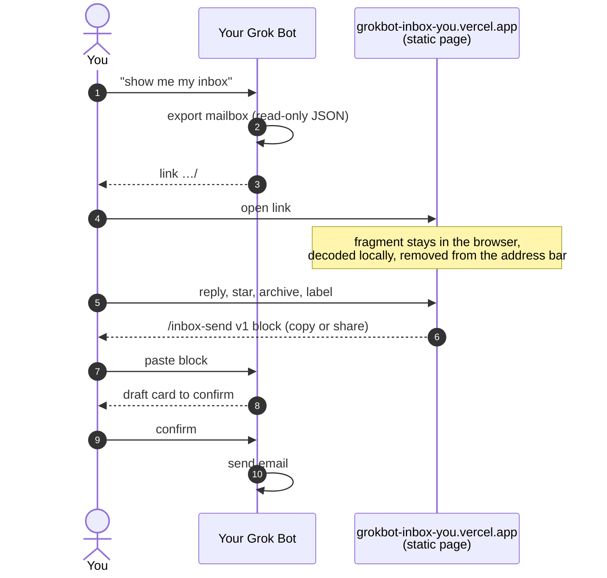

<div align="center">

# Grok Bot Inbox

**Your Grok Bot's email inbox in a proper browser UI. Private by design: no server, nothing uploaded.**

[](https://github.com/mascarock/grokbot-inbox/actions/workflows/pages.yml)
[](LICENSE)
[](https://vercel.com/new/clone?repository-url=https://github.com/mascarock/grokbot-inbox&project-name=grokbot-inbox)


</div>

Grok Bot has no public API for reading or sending mail; only the bot that owns a mailbox can do either. So your bot does the reading and hands you a link. The link carries the whole export in its URL fragment, which browsers never send to a server. The page decodes it locally, shows it like a mail client, and when you reply it hands a short text block back to your bot, which sends only after you confirm.

## Get started in 1 click

1. **Import the public bot template:** `BOT_TEMPLATE_LINK` <!-- TODO: replace with the published Grok Bot template link -->
2. Tell your bot **show me my inbox** (or `show me my +roma inbox` for one plus-address).
3. First time only, the bot asks you to **connect Vercel** (one click, free account). It publishes your own copy of this viewer at `https://grokbot-inbox-<you>.vercel.app/` straight from this repository and waits for the build.
4. The bot exports its mailbox read-only and **sends you a link** to your copy with the inbox already loaded.

No account here, no central host. Every person's copy runs on their own free Vercel project, and pushes to `main` here redeploy linked copies.

**Try the demo** with a fictional inbox (`demo+roma@mail.grokbot.com`, everyone on `example.com`):

https://grokbot-inbox-mascarock.vercel.app/#data=7VrbVttIFv2VWn5J94qNryTgIUzbDtiGcDMYDMM8lKSyVLikUkolG6dX1pqPmC-cL5lzSvLdcTAr3Z2HzgOgup_L3ufUqfye4YElnzPVjMN8-VZJn_7mUy52XCUHltQ7tvQz2Qx7DqXSzKlpGFkqlN7lioVcqXxTrFQLu9VC4WE2RsGIiPqhYNCmPcWoE2Wq__o9wx3o0V5Os0BDVxRbT8zG9c4Y0zxwSSh5oAnVRHuMSEUDl5F0cEiV5jYPaaCTxQLqM5haE9xm5Oh5sh91HMUiGJKh2PMbS3qMFF-z02kfQVZSl3phxgYFfP13NiNopM9gJHXZihbK1Uoh1YKfDGnIGA5eLWczfSkco5T2ef2iNxsxpxTf6CRXhE6HK1AKlwE0w1-MD5kDzX04V6b6SrEzWs7r7DXCO1SzeZlLN0UUOJV5K1Nq9owjGzQgI0Z8mLBmHLHGpsmlymEB_NLsn4_BY9AmNsyzGHYqRlAtxJxkh7T7hGuiKA-iLAEHZCQKpSb_-89_zUpmVY9GhJKIO4yMqBA7uKTRJepCa2p7Ppt4WJ8Llmos4m5AdazYThi4MNSWAS53Mw6xl_tgzXzSE_Ev0FTcq2QBV4IH8KFVzOZXbzvJijmabhwrgQagmlanS_3DohF7V8ny2_pFZ1Q4bbqyBv_Or7veUdeFv1r4ozZo1O7hV71xernLsKFfEEdXt51KKS5fX10Nau2rWu2qe3n_vPveP7s_vu3X_EZHPbVc-nT2MFKRF37hH2v10TEt3FXq7K37Oe-e5p9Ob_O12_Jw9_OTqrRk74s4heahPB32L7qqt3fc2zu5M38PL09va5_ej497o2NsxzGVxrAyFv2RaRs1kzX36r29-i38fH5bv6q3olEjtgoFJjqnD_tGlPpJp7t7pAYnrut--ABOh3CdR0dpCR1R4k5LyNjauZfRsRW01iCjfFPYrxZKK8josCp5OTruWQQe_UYI9PU18IAm4_ZkxLVnei0aBEwRGjjo4cCXDLYZQQt0DIyj3yCeFB0yQUIKs3hEGI04DJkuYiuQhsg-THKAocw0BNC8VhdgsmKl8s_LYbZtVpiNZ0OU4gUWnef311r0kqk-zDN8NG9J4CyeKLpNEt0ytKAMWC4EMiA-DXfIzYTAwGYySJhxZsksCaROSU4parOJ6yg8mqYhEKVUc15itrtmjIxlPHWlGRk-BqlVyLWOHS4fgxWL4NiLAM4VZ8kFSFUqZQkqbOaYtTOyYGFysLLIIRkpqVn1MTgkrwkHh-SHh4NDXPUFEQE8J2Y5tE3o9FciAg1DWIIiBPJJfxoX3r8rlvaSr488CgUdw-ji-xI5rWdmEaNPRbQaMmAzyBAQb39Hpr84Ms1YD9JZQ5UrxFDHVhJyexCHBn3XaCYHDL4mmZ1Rkk-VLVey1h-SoxZnmfq6DNSI8ZIUdPNhJzz96swS4udetbjKtpsUmlKsGQKIBibgAQA7iWYpmwRwN_GIw6IkGAI9APkpgjhCVvV5FAFbZoEYgDlxAg414RQ-xhAioXmkOC4IY3y46lA1RpreIZcC4ihMkIaHFQsVBgNcY-RJYL4IADaYxtIz1NpmdhHSlbkEpT8U13669d-4XofrJWYNIZCqF6q_Uth_t0zrlUVS_6ZRko0WE94EjKWfAIzztPFyhksBeTNNKQFhglpMQG7TuTg7MrgymQ-JA7gdTwGXpDKQ4nCd5kQGeIsRfq9aTrKVFZnTtORY8TQtKc_SEmQVzEpWJs1lIS9lkM3wTazHwWle6D6lQmUlK6CWjEGAVSdajj82tQRQ-bJ5LpXEL5lcCZILwXTot8op29-eplM_Mbk2mRdMrmTYG8IUkv_u2lJKcX3cSmRaCVx_0O1wGynXR7b1YNporRRNbUj27QEzAYmEkwkQsUaStD6etdMJ2TV3wEgrHk7iHk73IN0l4GCCzd8p-lSZRDhrvmBXFkSgTmJL5SAgzA1CxPADPhTDuwpeUwn8NgfjCBQMplIFEEy_f31cgA1KB7Nygkd6Rz_rFeCgHvIADx7MkFMsruTNc9FtNmMS3rr-vn64rnPnTkQPjfrgvjdwK7LRbTcfwvtyJ7RKu57VqI_u784VvdsN2s3n0C5fnTZ4we22TobUv31ymvtj_L5tOcP2kXd00x2496VjbjVvv5hx5bpn-13Xbu6XH3pt1y53xrRXO_10XT9mrY6wgnPYpwJz9scPjZq895-LeCZ6VwkbbtilTfEFz2M1uy7tnbmWv19oN49c27_Fs3lOq-Pdlzz9cLdb-MTrJ06jLhjMcVpnrl3ac52mJ9qtc8_q1SNYN7T8kyFr1OV9D_tB_l5HGtlanWG7uT96uKvEjXWprYgD21vw1U_YQgJGE8oG2o_9DXwCMgU2JR0JydUCXizT8aeUZ0s3xXfVylacYuTeohy7nZh_YSljURffNWtKPC1IiWXWlAdIn42wPhQnQdJV1LKwyGA0Rmhfp7HcXK_9pDiSlC8AhbbJA4CZPIikSDSDJJ4v3eyzs6wbb_cRw_g7YmII0_tYJKBKgR2Ili7DrGBa3JokILhXknMMGQyhCqyQHAK4jSkX9kGOmSM-R0o1ZavEmiC-p31kkoPwMNHAQT48hI-fUwnp4X6AHtKVzmgI2V1QJQeUeIr1PzyCQnQYVfP5OTfLw9lZzoq5cHKwZd7o4DFz-L0hB3l6aDbivksiZc-tbvKjaGd-hQSQafEKMqfHDIigYU5biBiCG4gJUROiIQNdBhr2P4hsCHn6kIKg-pc3z1H05teDfNp4EMLgsWCwgAVBB9AFWWjO7FuF6PHLhpNYLu7_K-zQAKmIFweuGk9UNvMebPjOHc-IhDWp6KXBbrdSWKkdrakcIfCRNZJnveTVaZHXwY9AlsWixV3SBg4FPAa_jb3INwoWqQyT0t6FcmkA51LRAonJafOfQvQFU3kvbKhxpHJvweyvlfAPeHJbFO9lhksJ_JtDUuoEAjCc1OdGI1TgLYxNMr7kMZeYd-Id8hEoAvgiBPIAStqHq1iSLfa5AipBmbDeoXSUloKxP6Wyxbp3ZJr8hQI6N1UZAmRFhIySK2CHhWKMRzepZfKgPBkYMFMsNxcuzFJTk8J9EUIYw3vgREiE5npjLr1nLAAFHJ-vXq2usWCMGfUc16NXGuk3wKXhCcmw_qMNqGeeYGPH9hgxp9sOJMX9m-Ie3De3yYbMNltgZisxXwyUDcIuIWVJxu1sN1e5iKZDMUCGKTLQlwWjQywTrK5gfO2OpeVCDO7GcRkZcjZKH4lgAQtfYuzBxE8dbgIbOZeEfY55iN6IE20I8mPzlIHOPqI426QCWawyzqEiNZvZ_SNEei7w0SPGbCRKkghIVKpkXfxGKXMo5QQlxnzfef2YCLPzFH6rvvEUsrkCR6UA_5aDV6lcecnDR-hJLfHpA8EJ5o5krGyGDjfkdP4_myAzXARiPCm2IYlB__GU1ZKRqGdUJAwXKatlvn79Pw

## How it works



- **Reading**: the bot writes an export per [docs/SCHEMA.md](docs/SCHEMA.md) and turns it into a `#data=` link with [tools/make_link.py](tools/make_link.py) ([format](docs/LINK.md)). Links hold thousands of text-only threads; `--lite` drops quotes and HTML to stay short, and the bot sends the file when even that is too long.
- **Writing**: the page never sends mail and never calls an API with mail data. It formats a `/inbox-send v1` block ([spec](docs/COMMANDS.md)) that you paste to your bot. The bot checks the sender is one of its own inboxes, shows a draft card, and sends only on your confirmation. A **Refresh** button copies `/inbox-refresh`, and the bot answers with a fresh link.

### Privacy, concretely

- `#data=` is a URL **fragment**. The request your Vercel project sees is `GET /`. The fragment is decoded in the page, then removed from the address bar with `history.replaceState` so it is not bookmarked, copied, or kept in history.
- The inbox lives in memory and in this tab's **`sessionStorage`** so a reload works. **Forget** in the pill clears it.
- HTML mail is **sanitized with DOMPurify** and rendered in a **sandboxed iframe** with a strict CSP. Scripts never run. **Remote images stay blocked** until you turn them on for one message.
- Stars, archive, labels, read marks, and drafts are in `localStorage` under `grokbot-inbox:state:<inbox>`; they never leave the browser.
- No analytics, no font or icon CDN, and no network call except the ones you ask for (`?src=`, or "Load remote images").
- The only mail in this repository is the fictional sample. `exports/` and `*.export.json` are gitignored.

## Features

- **Compose, reply, reply all, forward** with prefilled recipients (your own address left out), one `Re:`/`Fwd:`, a collapsible quoted original, and autosaved drafts. **Send with my bot** copies the command block; **Share** uses the system share sheet on phones.
- **Star, archive, label, read/unread**, kept locally per inbox. Folders Inbox / Unread / Starred / Archived with counts, plus label, plus-address, direction, and full-text search filters.
- **Command palette** (`⌘K` / `Ctrl+K`): fuzzy-search actions, folders, labels, addresses, threads.
- **Keyboard first**: see the table below, or press `?` in the app.
- **Mobile**: list → thread → compose, one screen at a time.
- **Dark and light**: dark by default, light if your system prefers it, toggle remembered.
- **Attachments**: file names, types, and sizes; a link when the bot provides a safe URL. Inline signature images hidden until asked.
- **Open any export**: drop a `.json` file, use **Open export**, or pass `?src=` (that one is a query string, so prefer links for real mail).

| Key | Action | Key | Action |
| --- | --- | --- | --- |
| `⌘K` / `Ctrl+K` | Command palette | `c` | New message |
| `j` / `k` | Next / previous thread | `r` | Reply |
| `Enter` | Open thread (mobile) | `a` | Reply all |
| `/` | Search | `f` | Forward |
| `e` | Archive / unarchive | `s` | Star / unstar |
| `u` | Mark unread | `Esc` | Close compose, palette, help |
| `?` | Shortcut cheatsheet | | |

<details>
<summary>More screenshots</summary>

Light theme


Compose with the command block preview


Command palette


Mobile


</details>

## Self-host

Your bot does this for you, but every option works by hand.

**Vercel.** [](https://vercel.com/new/clone?repository-url=https://github.com/mascarock/grokbot-inbox&project-name=grokbot-inbox) clones the repository into your account and deploys with [`vercel.json`](vercel.json) (Vite, `npm run build`, `dist/`, base `/`). Then point links at it:

```sh
python3 tools/make_link.py export.json --lite --base https://your-copy.vercel.app/
```

Without `--base` the script falls back to the demo copy and says so on stderr. Accounts without a GitHub connection can deploy the prebuilt [`dist.tar.gz`](https://github.com/mascarock/grokbot-inbox/releases/latest) that [`release-dist.yml`](.github/workflows/release-dist.yml) publishes on every push to `main`.

**GitHub Pages.** [`pages.yml`](.github/workflows/pages.yml) builds and publishes `dist/` on pushes to `main`. Turn it on under **Settings → Pages → Source: GitHub Actions**. For a project site under a sub-path, set the repository variable `VITE_BASE_PATH` to `/your-repo-name/`. Pull requests run lint, tests, and the build without deploying.

**Local.** Node 20+ (Python 3 for the link-script tests).

```sh
npm install
npm run dev        # http://localhost:5173/
npm test && npm run lint && npm run build
```

If you change `examples/sample-inbox.json`, rebuild the demo link above with `python3 tools/make_link.py examples/sample-inbox.json`; a test checks that they match.

## For bot builders

Anything that can write the JSON can use this viewer.

| Doc | What it covers |
| --- | --- |
| [bot/SKILL.md](bot/SKILL.md) | The Grok Bot skill: deploy the owner's copy via the Vercel connector, export read-only, make the link, handle `/inbox-send` with a confirm card, handle `/inbox-refresh`. |
| [docs/SCHEMA.md](docs/SCHEMA.md) | Export format, with [schema/inbox.schema.json](schema/inbox.schema.json) and [src/types/inbox.ts](src/types/inbox.ts). |
| [docs/LINK.md](docs/LINK.md) | `#data=` encoding (`base64url(deflate_raw(utf8(json)))`), size limits, lite mode. |
| [docs/COMMANDS.md](docs/COMMANDS.md) | `/inbox-send v1` and `/inbox-refresh v1`: grammar, JSON-schema-style spec, `---` escaping, header-injection rules. |

Tools: [tools/make_link.py](tools/make_link.py) (Python 3, stdlib only) and [tools/make_link.mjs](tools/make_link.mjs) (Node) do the same thing. Sources live behind a small adapter, `InboxSource` in [src/sources/](src/sources/), so a new producer does not touch the UI.

## Roadmap

See [docs/ROADMAP.md](docs/ROADMAP.md). Short version: larger inboxes split into per-tag links, attachment URLs when the bot has a safe place to serve them, other mail producers. Not planned: a hosted backend of any kind.

## Contributing

Issues and pull requests are welcome. Keep the constraints: static only, no mail leaves the browser except through the owner's bot, no new runtime dependencies without a reason. Before pushing run `npm test && npm run lint && npm run build`. Never commit a real export; use the fictional sample.

## License

[MIT](LICENSE) © Niccolò Mascaro. Not affiliated with xAI, X, Cursor, or Vercel; names are used to describe interoperability.
