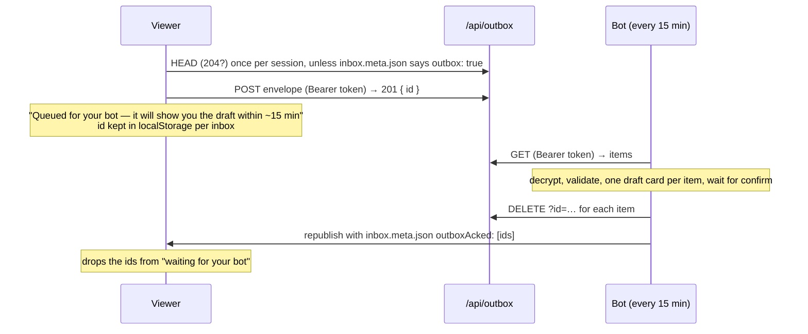

# The live relay: encrypted snapshots in, encrypted replies out

This is the "nothing to copy or paste" mode of the viewer. Everything runs in the owner's own accounts: their Grok Bot (which can read the mailbox and has the Vercel connector) and their own free Vercel project `grokbot-inbox-<handle>`. There is no shared server and no third-party storage; the only state outside the bot's machine is ciphertext on the owner's project.

```mermaid
flowchart LR
    M([New mail]) --> B[Bot: export → encrypt → create_deployment]
    B -- "inbox.enc (ciphertext) + viewer files" --> V[(grokbot-inbox-you.vercel.app)]
    V -- "GET /inbox.enc, no-store" --> P[Browser: AES-256-GCM decrypt with #k]
    P -- "POST ciphertext" --> O[/api/outbox → Blob store, private]
    O -- "every 15 min: pull, decrypt, ack" --> C{Draft card}
    P -. "optional: POST JSON (direct, or via /api/relay)" .-> W[Bot webhook routine]
    W -.-> C
    C -- confirm --> S([Send])
```

The bot-side steps are written out in [bot/SKILL.md](../bot/SKILL.md) (Parts A, E, F, G). This page is the format reference.

## 1. The link: `#k=`

```
https://grokbot-inbox-<handle>.vercel.app/#k=<base64url 256-bit key>
```

- The key is 32 random bytes, base64url without padding (43 characters). It is generated **once per owner** by the bot (`encrypt_inbox.mjs keygen --key-file …`), kept on the bot's machine with mode `0600`, and never committed, deployed, or pasted into chat other than inside this one link to the owner.
- It lives in the URL **fragment**, which browsers never send over the network. The viewer reads it on load, removes it from the address bar with `history.replaceState`, and stores it in `localStorage` (`grokbot-inbox-snapshot-key`) so the bare `https://grokbot-inbox-<handle>.vercel.app/` keeps working on that device. **Forget this device** (pill, settings, or the palette) deletes it.
- Rotating the key means `keygen --force`, one new publish, and one new link to the owner. Old devices then show "This key does not open the snapshot".

The older `#data=` link ([LINK.md](LINK.md)) still works and takes precedence when both are present; it is the fallback for bots that cannot publish.

## 2. The snapshot: `/inbox.enc` and `/inbox.meta.json`

Both files sit at the root of the owner's deployment next to `index.html`, served with `Cache-Control: no-store` ([vercel.json](../vercel.json)).

`inbox.enc` is a JSON envelope:

```json
{
  "v": 1,
  "alg": "A256GCM",
  "iv": "<base64url, 12 bytes>",
  "ct": "<base64url, ciphertext || 16-byte tag>",
  "updatedAt": "2026-10-23T14:05:00.000Z",
  "seq": 128,
  "cmp": "deflate-raw"
}
```

| Field | Meaning |
| --- | --- |
| `v` | Envelope version. Only `1` exists. |
| `alg` | Only `A256GCM` (AES-256-GCM, 128-bit tag, no additional data). |
| `iv` | Fresh random 96-bit nonce per snapshot. Never reuse an IV under the same key. |
| `ct` | `AES-GCM(key, iv, plaintext)`; plaintext is the UTF-8 export JSON ([SCHEMA.md](SCHEMA.md)), raw-DEFLATE-compressed when `cmp` is `deflate-raw`. |
| `updatedAt` | When the bot produced it. Shown as "updated 4 min ago". |
| `seq` | Monotonic counter. The viewer swaps the inbox only when `seq` grows (or `updatedAt` is later at equal `seq`). |
| `cmp` | Optional; `deflate-raw` or absent. |

`inbox.meta.json` is `{ "seq": 128, "updatedAt": "…", "outbox": true, "outboxAcked": ["outbox/…enc"] }`, a few bytes the viewer polls first so it only downloads the envelope when something changed. If it is missing the viewer fetches the envelope directly. `outbox` (optional) says the bot finished setting up `/api/outbox` (§6); `outboxAcked` (optional) lists outbox item ids the bot has picked up in the last day, so the viewer can clear its "waiting for your bot" list. Both come from `encrypt --outbox --acked …`.

The export inside may carry an optional `relay` block so the owner only pastes the webhook **key**, never the URL:

```json
"relay": { "webhookUrl": "https://…/webhook", "keyHeader": "Authorization", "keyPrefix": "Bearer " }
```

Never put the key itself in the export. The viewer drops any `relay.key` it finds.

### Producing it

Node 20+, no dependencies:

```sh
node bot/encrypt_inbox.mjs keygen --key-file ~/.grokbot-inbox/<handle>.key        # once
node bot/encrypt_inbox.mjs encrypt --in /tmp/inbox-export.json \
     --key-file ~/.grokbot-inbox/<handle>.key --out-dir /tmp/publish \
     --webhook-url https://…/webhook                                              # every time
node bot/encrypt_inbox.mjs link --base https://grokbot-inbox-<handle>.vercel.app/ --key-file ~/.grokbot-inbox/<handle>.key
```

`encrypt` writes `inbox.enc` and `inbox.meta.json`, bumps `<key-file>.seq`, and never prints the key. [bot/encrypt_inbox.py](../bot/encrypt_inbox.py) does the same with Python 3 and the `cryptography` package (the standard library has no AEAD cipher; without the package it exits 3 and tells you to use the Node script).

### Reading it

The viewer ([src/sources/snapshotSource.ts](../src/sources/snapshotSource.ts), [src/lib/crypto.ts](../src/lib/crypto.ts)) fetches with `cache: 'no-store'`, decrypts with WebCrypto, parses with the normal export parser, and then:

- polls `inbox.meta.json` every **60 s while the tab is visible**, and immediately on `focus` / `visibilitychange`;
- on a newer `seq`, decrypts the new envelope and swaps the thread list **in place**: selected thread, filters, open compose window, and all local state (read, star, archive, labels, drafts, keyed by stable ids in `localStorage`) stay as they were;
- shows "updated X min ago" in the sidebar and a dimmed "offline" marker if the last check failed.

## 3. Auto-publish from the bot

The bot republishes the whole site, so the snapshot is just another static file in a normal Vercel deployment. No storage product, no token, no environment variable.

1. Download the prebuilt viewer once per run (or reuse a cached copy whose `dist-manifest.json` commit has not changed): `https://github.com/mascarock/grokbot-inbox/releases/latest/download/dist.tar.gz`. The bundle already contains `api/relay.js`, a build-less `vercel.json`, and a `package.json` with `"type": "module"`.
2. Export, encrypt, and drop `inbox.enc` + `inbox.meta.json` into the same directory.
3. Once per project, `update_project` with `requestBody: { framework: null, buildCommand: "", installCommand: "", outputDirectory: null }`. Empty strings mean *no command*; `null` would mean *auto-detect*, and a project once set to Vite then runs `npm ci` and fails with `missing_lock_file`.
4. `upload_file` for each file in the deploy set (`xVercelDigest` = SHA-1 and `contentLength` top-level, `requestBody` = the base64 string; [bot/publish_files.mjs](../bot/publish_files.mjs) `file` prints exactly that and `list` skips `.nojekyll` / `dist-manifest.json`), then `create_deployment` with `skipAutoDetectionConfirmation: "1"` top-level and `requestBody: { name, target: "production", files: [{ file, sha, size }, …], projectSettings: <same as step 3> }`. The connector cannot inline a dozen files in one call. Vercel serves the static files from the root and builds `api/relay.js` as a Node function.
5. Poll `get_deployment` until `READY`. The production alias does not change, so the owner's link keeps working; their open tab picks the new snapshot up within a minute.

**Why is the snapshot a deployment and not a blob?** Publishing needs only the connector the bot already has: no store, no token, no environment variable, and a deployment per snapshot costs nothing on Hobby. The outbox (§6) does use a Blob store, because the browser has to *write* somewhere and the bot cannot deploy on the browser's behalf; the bot creates and connects that store once through the same connector.

**Why not link the project to the GitHub repository?** A push to `main` would redeploy the viewer without `inbox.enc` and blank the inbox until the next publish. Keep the project unlinked; the bot refreshes the viewer files on every publish anyway. The connector cannot remove an existing Git link: create a fresh project, have the owner disconnect under *Settings → Git*, or as a stopgap set `commandForIgnoringBuildStep: "exit 0"` so Git-triggered builds are cancelled (bot/SKILL.md A3).

**Webhook URL prefill is optional.** The routine panel shows the webhook URL and key only to the owner. The bot includes `relay.webhookUrl` only if the owner pasted the URL into chat; otherwise the owner enters both in the viewer's Settings.

### Limits and the debounce

Vercel Hobby (free) allows **100 deployments per rolling 24 hours** per account, 100 GB bandwidth and 1M function invocations per month, and 10 s default function duration (the relay sets `maxDuration: 20`; Hobby allows up to 60). Each publish is one deployment, so the bot:

- publishes **at most once every 5 minutes**, coalescing new mail that arrives during the wait into the next snapshot;
- keeps a daily budget of **80 publishes** and, once spent, publishes hourly until the window rolls over;
- never publishes when the export is identical to the previous one (same thread ids and `lastMessageAt`), and always publishes when the owner asks (webhook `inbox-refresh` or chat).

## 4. Replies: the payloads

Whatever the route (outbox §6, or webhook below), the thing that reaches the bot is one of these JSON payloads. They mirror the paste-able commands in [COMMANDS.md](COMMANDS.md):

```json
{
  "type": "inbox-send", "v": 1,
  "from": "you+roma@mail.grokbot.com",
  "kind": "reply",
  "threadId": "th-tent", "inReplyTo": "m-tent-3",
  "to": [{ "name": "Alice Example", "address": "alice@example.com" }],
  "cc": [{ "address": "events@example.com" }],
  "subject": "Re: Meeting point at the orange tent",
  "body": "Perfect, see you at the tent.\n\nOn Oct 23 … wrote:\n> Orange tent it is.",
  "command": "/inbox-send v1\nfrom: …\n---\n…",
  "sentAt": "2026-10-23T14:06:00.000Z"
}
```

```json
{ "type": "inbox-refresh", "v": 1, "inbox": "you+roma@mail.grokbot.com", "sentAt": "…" }
```

```json
{ "type": "inbox-action", "v": 1, "inbox": "…", "action": "archive", "threadId": "th-tent", "sentAt": "…" }
```

- `kind` is `new | reply | reply-all | forward`; `threadId` / `inReplyTo` appear only for replies.
- `command` is the same message rendered as the `/inbox-send v1` block, so a bot can reuse the parser and the rules it already has for Part C. The two must agree; if they do not, the bot stops.
- `inbox-action` is reserved; the viewer does not send it yet (archive, star, and read state stay local). The outbox and `bot/outbox.mjs` accept it so a future viewer can use it.
- The bot treats every field as **untrusted input** and never sends anything without the owner confirming a draft card ([bot/SKILL.md](../bot/SKILL.md) Parts F and G).

### Which route the viewer takes

1. **Webhook**, if the owner configured one in Settings (instant; this section). A definite `4xx` from the webhook is final; CORS or network trouble is retried through `/api/relay`.
2. **Outbox** (§6), if the snapshot meta says `outbox: true` or a `HEAD /api/outbox` answered `204`. Also the fallback when the webhook and the relay both fail.
3. **Copy** the `/inbox-send v1` block for pasting ([COMMANDS.md](COMMANDS.md)).

### Webhook: authentication header

Grok Bot routines issue a **per-routine sender key**. The exact header name is not fixed yet, so the viewer makes it configurable in **Settings** (sidebar gear or `⌘K` → Settings):

| Setting | Default | Stored |
| --- | --- | --- |
| Webhook URL | prefilled from `relay.webhookUrl` in the snapshot | `localStorage` |
| Sender key | empty; the owner pastes it once | `localStorage`, this device only |
| Key header | `Authorization` | `localStorage` |
| Key prefix | `Bearer ` | `localStorage` |
| Always use `/api/relay` | off | `localStorage` |

The request is `POST <url>` with `Content-Type: application/json` and `<header>: <prefix><key>`.

### Direct first, then `/api/relay`

Whether the webhook endpoint allows browser CORS is also unknown. The viewer tries a direct `fetch` first. If the browser blocks it or the network fails, it POSTs the same body to `/api/relay` **on its own origin**, with `X-Relay-Target`, `X-Relay-Header`, and `X-Relay-Auth` headers. A definite `401`/`403`/`4xx` from the webhook is final and is not retried through the relay.

[api/relay.js](../api/relay.js) is a Vercel Node function on the owner's project that:

- accepts `POST` only, same-origin only (the `Origin` header, when present, must match the host);
- forwards only to `https://` URLs whose host is, or ends with, an entry of the allowlist in [src/lib/relayAllowlist.ts](../src/lib/relayAllowlist.ts) (`x.ai`, `grok.com`, `cursor.com`, `cursor.sh`), so it cannot be used as an open proxy;
- caps the body at 256 KB, requires valid JSON, follows no redirects, times out after 15 s;
- returns only `{ ok, status }` or `{ error }`; it never logs or echoes request or response bodies.

If the real webhook host turns out to be elsewhere, add its suffix to the two allowlists and let the release workflow ship a new bundle.

## 5. What is and is not a secret

| Thing | Where it lives | Secret? |
| --- | --- | --- |
| Snapshot key | Bot machine (`0600` file) and the owner's browsers | Yes. Anyone with it and the URL can read the mail. |
| `inbox.enc` | Public on the owner's Vercel project | No. AES-256-GCM ciphertext. |
| Webhook URL | In the snapshot (encrypted) and in the browser | Mildly. Useless without the key. |
| Webhook sender key | Owner's browser only | Yes. Lets anyone post payloads to the bot; the bot still shows a draft card before sending. |
| Outbox token | Derived from the snapshot key in the browser and on the bot; never stored | Yes, but it is nothing new: whoever has the key has it. Lets one post ciphertext to the outbox; the bot still shows a draft card. |
| `OUTBOX_TOKEN_SHA256` | Env var on the owner's project | No. A hash; cannot be turned back into the token. |
| `BLOB_READ_WRITE_TOKEN` | Env var on the owner's project, created by Vercel | Yes, to Vercel's own Blob store. Only `/api/outbox` reads it; it never leaves the function. |
| Outbox items (`outbox/*.enc`) | Private blobs in the owner's store | No. AES-256-GCM ciphertext, deleted once the bot acknowledged them. |
| Vercel access | The bot's connector | Yes, and it already existed before this feature. |

## 6. The outbox: `/api/outbox`

Replies without a webhook. The browser cannot deploy, so it needs somewhere to *write*: a Vercel Blob store on the owner's own project, created once by the bot with `create_storage_stores_blob` (`access: "private"`, `projectId` set, which connects it and creates `BLOB_READ_WRITE_TOKEN`; SKILL.md Part G). [api/outbox.js](../api/outbox.js) is a dependency-free Node function in the release bundle, like the relay.

### Keys and token

Everything derives from the snapshot key `k` (§1); there is no second secret to hand out.

| | |
| --- | --- |
| Item encryption | `AES-256-GCM(k, iv, plaintext, aad)` with `aad = "grokbot-inbox/outbox/v1"` (UTF-8). The AAD binds the ciphertext to its purpose: a snapshot cannot be replayed as an item or vice versa. |
| Item envelope | `{ "v": 1, "alg": "A256GCM", "iv": "<base64url 12 bytes>", "ct": "<base64url ct ‖ tag>" }` and nothing else. The plaintext is the §4 payload as JSON. |
| Bearer token | `base64url(HMAC-SHA256(key = k, message = "grokbot-inbox/outbox/v1"))`, 43 characters. Computed by the viewer ([src/lib/crypto.ts](../src/lib/crypto.ts) `deriveOutboxToken`) and by `bot/outbox.mjs token`. |
| What the server stores | `OUTBOX_TOKEN_SHA256` = hex `sha256(token)`, compared in constant time. The server never sees `k` and cannot decrypt anything. |

### The function

| Call | Who | Does |
| --- | --- | --- |
| `HEAD` / `OPTIONS /api/outbox` | viewer | Probe, no auth. `204` when both env vars are set, `503` otherwise. |
| `POST /api/outbox` | viewer | `Authorization: Bearer <token>`, body = one envelope. Shape check only (`v`, `alg`, 96-bit `iv`, `ct` ≥ tag length, base64url, no other keys), 256 KB cap, best-effort per-IP rate limit (20/min per function instance), same-origin (`Origin`, when present, must match the host). Stores it as a **private** blob `outbox/<yyyymmddThhmmssmmmZ>-<12 hex>.enc`; answers `201 { "id" }`. |
| `GET /api/outbox` | bot | Same bearer. Lists up to 50 pending items, oldest first: `{ "items": [{ "id", "at", "size", "envelope" }], "hasMore" }`. |
| `DELETE /api/outbox?id=outbox/….enc` | bot | Same bearer. Removes one item; `404` if already gone. |
| any | | `401` on a missing or wrong token; `503` with a plain-language message when `BLOB_READ_WRITE_TOKEN` or `OUTBOX_TOKEN_SHA256` is missing; `502` when the Blob API fails (no details echoed). Bodies are never logged. |

Blob access is through Vercel's REST API (`https://vercel.com/api/blob`, `x-api-version: 13`) with the project's `BLOB_READ_WRITE_TOKEN`. Items are written with `x-vercel-blob-access: private` and no random suffix; `OUTBOX_BLOB_ACCESS=public` is an escape hatch for stores that predate private blobs (the content is ciphertext under an unguessable name either way).

### Lifecycle



The viewer side is [src/lib/outbox.ts](../src/lib/outbox.ts): `probeOutbox`, `postToOutbox`, `deliverPayload` (webhook → outbox → copy), and the local queue (`localStorage` key `grokbot-inbox-outbox:<inbox>`), reconciled against `outboxAcked` on every snapshot poll. The bot side is [bot/outbox.mjs](../bot/outbox.mjs):

```sh
node bot/outbox.mjs token --key-file ~/.grokbot-inbox/<handle>.key          # → hex for OUTBOX_TOKEN_SHA256
node bot/outbox.mjs probe --url https://grokbot-inbox-<handle>.vercel.app   # → "ready" or why not
node bot/outbox.mjs pull  --url https://… --key-file …                     # → JSON [{ id, at, payload | error }]
node bot/outbox.mjs ack   --url https://… --key-file … --id outbox/….enc    # → deletes
```

`pull` decrypts locally, runs a structural check on each payload (`validatePayload`: type, version, addresses, one-line headers, non-empty body, a `/inbox-send v1` command block), and reports items it cannot use as `{ id, error }` so the bot can still acknowledge them.

### What Vercel can see

The ciphertext and its size, the time each item was posted and picked up, the caller's IP, and that the bearer token hashed to the stored value. Not the key, not the token, not a recipient, subject, or word of any reply.
