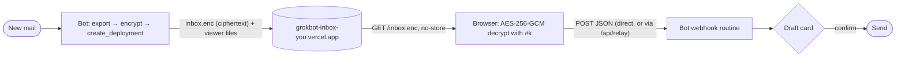

# The live relay: encrypted snapshots in, webhook replies out

This is the "nothing to copy or paste" mode of the viewer. Everything runs in the owner's own accounts: their Grok Bot (which can read the mailbox and has the Vercel connector) and their own free Vercel project `grokbot-inbox-<handle>`. There is no shared server, no third-party storage, and no secret beyond the Vercel connector the bot already has.



The bot-side steps are written out in [bot/SKILL.md](../bot/SKILL.md) (Parts A, E, F). This page is the format reference.

## 1. The link: `#k=`

```
https://grokbot-inbox-<handle>.vercel.app/#k=<base64url 256-bit key>
```

- The key is 32 random bytes, base64url without padding (43 characters). It is generated **once per owner** by the bot (`encrypt_inbox.mjs keygen --key-file …`), kept on the bot's machine with mode `0600`, and never committed, deployed, or pasted into chat other than inside this one link to the owner.
- It lives in the URL **fragment**, which browsers never send over the network. The viewer reads it on load, removes it from the address bar with `history.replaceState`, and stores it in `localStorage` (`grokbot-inbox-snapshot-key`) so the bare `https://grokbot-inbox-<handle>.vercel.app/` keeps working on that device. **Forget this device** (pill, settings, or the palette) deletes it.
- Rotating the key means `keygen --force`, one new publish, and one new link to the owner. Old devices then show "This key does not open the snapshot".

The older `#data=` link ([LINK.md](LINK.md)) still works and takes precedence when both are present; it is the fallback for bots that cannot publish.

## 2. The snapshot: `/inbox.enc` and `/inbox.meta.json`

Both files sit at the root of the owner's deployment next to `index.html`, served with `Cache-Control: no-store` ([vercel.json](../vercel.json)).

`inbox.enc` is a JSON envelope:

```json
{
  "v": 1,
  "alg": "A256GCM",
  "iv": "<base64url, 12 bytes>",
  "ct": "<base64url, ciphertext || 16-byte tag>",
  "updatedAt": "2026-10-23T14:05:00.000Z",
  "seq": 128,
  "cmp": "deflate-raw"
}
```

| Field | Meaning |
| --- | --- |
| `v` | Envelope version. Only `1` exists. |
| `alg` | Only `A256GCM` (AES-256-GCM, 128-bit tag, no additional data). |
| `iv` | Fresh random 96-bit nonce per snapshot. Never reuse an IV under the same key. |
| `ct` | `AES-GCM(key, iv, plaintext)`; plaintext is the UTF-8 export JSON ([SCHEMA.md](SCHEMA.md)), raw-DEFLATE-compressed when `cmp` is `deflate-raw`. |
| `updatedAt` | When the bot produced it. Shown as "updated 4 min ago". |
| `seq` | Monotonic counter. The viewer swaps the inbox only when `seq` grows (or `updatedAt` is later at equal `seq`). |
| `cmp` | Optional; `deflate-raw` or absent. |

`inbox.meta.json` is `{ "seq": 128, "updatedAt": "…" }`, a few bytes the viewer polls first so it only downloads the envelope when something changed. If it is missing the viewer fetches the envelope directly.

The export inside may carry an optional `relay` block so the owner only pastes the webhook **key**, never the URL:

```json
"relay": { "webhookUrl": "https://…/webhook", "keyHeader": "Authorization", "keyPrefix": "Bearer " }
```

Never put the key itself in the export. The viewer drops any `relay.key` it finds.

### Producing it

Node 20+, no dependencies:

```sh
node bot/encrypt_inbox.mjs keygen --key-file ~/.grokbot-inbox/<handle>.key        # once
node bot/encrypt_inbox.mjs encrypt --in /tmp/inbox-export.json \
     --key-file ~/.grokbot-inbox/<handle>.key --out-dir /tmp/publish \
     --webhook-url https://…/webhook                                              # every time
node bot/encrypt_inbox.mjs link --base https://grokbot-inbox-<handle>.vercel.app/ --key-file ~/.grokbot-inbox/<handle>.key
```

`encrypt` writes `inbox.enc` and `inbox.meta.json`, bumps `<key-file>.seq`, and never prints the key. [bot/encrypt_inbox.py](../bot/encrypt_inbox.py) does the same with Python 3 and the `cryptography` package (the standard library has no AEAD cipher; without the package it exits 3 and tells you to use the Node script).

### Reading it

The viewer ([src/sources/snapshotSource.ts](../src/sources/snapshotSource.ts), [src/lib/crypto.ts](../src/lib/crypto.ts)) fetches with `cache: 'no-store'`, decrypts with WebCrypto, parses with the normal export parser, and then:

- polls `inbox.meta.json` every **60 s while the tab is visible**, and immediately on `focus` / `visibilitychange`;
- on a newer `seq`, decrypts the new envelope and swaps the thread list **in place**: selected thread, filters, open compose window, and all local state (read, star, archive, labels, drafts, keyed by stable ids in `localStorage`) stay as they were;
- shows "updated X min ago" in the sidebar and a dimmed "offline" marker if the last check failed.

## 3. Auto-publish from the bot

The bot republishes the whole site, so the snapshot is just another static file in a normal Vercel deployment. No storage product, no token, no environment variable.

1. Download the prebuilt viewer once per run (or reuse a cached copy whose `dist-manifest.json` commit has not changed): `https://github.com/mascarock/grokbot-inbox/releases/latest/download/dist.tar.gz`. The bundle already contains `api/relay.js`, a build-less `vercel.json`, and a `package.json` with `"type": "module"`.
2. Export, encrypt, and drop `inbox.enc` + `inbox.meta.json` into the same directory.
3. Call the Vercel connector's `create_deployment` with `target: "production"`, the project name, every file inline, and `projectSettings: { framework: null, buildCommand: null, installCommand: null, outputDirectory: null }`. Vercel serves the static files from the root and builds `api/relay.js` as a Node function.
4. Poll `get_deployment` until `READY`. The production alias does not change, so the owner's link keeps working; their open tab picks the new snapshot up within a minute.

**Why not Vercel Blob / Edge Config / KV?** Each needs a store created on the project and a read-write token wired into an environment variable, plus an authenticated write path for the bot. That is one or two extra secrets and manual dashboard steps, which this project avoids. A deployment per snapshot costs nothing on Hobby and needs only the connector.

**Why not link the project to the GitHub repository?** A push to `main` would redeploy the viewer without `inbox.enc` and blank the inbox until the next publish. Keep the project unlinked; the bot refreshes the viewer files on every publish anyway.

### Limits and the debounce

Vercel Hobby (free) allows **100 deployments per rolling 24 hours** per account, 100 GB bandwidth and 1M function invocations per month, and 10 s default function duration (the relay sets `maxDuration: 20`; Hobby allows up to 60). Each publish is one deployment, so the bot:

- publishes **at most once every 5 minutes**, coalescing new mail that arrives during the wait into the next snapshot;
- keeps a daily budget of **80 publishes** and, once spent, publishes hourly until the window rolls over;
- never publishes when the export is identical to the previous one (same thread ids and `lastMessageAt`), and always publishes when the owner asks (webhook `inbox-refresh` or chat).

## 4. Replies: webhook payloads

The viewer POSTs JSON to the bot's **webhook routine**. Payload types mirror the paste-able commands in [COMMANDS.md](COMMANDS.md):

```json
{
  "type": "inbox-send", "v": 1,
  "from": "you+roma@mail.grokbot.com",
  "kind": "reply",
  "threadId": "th-tent", "inReplyTo": "m-tent-3",
  "to": [{ "name": "Alice Example", "address": "alice@example.com" }],
  "cc": [{ "address": "events@example.com" }],
  "subject": "Re: Meeting point at the orange tent",
  "body": "Perfect, see you at the tent.\n\nOn Oct 23 … wrote:\n> Orange tent it is.",
  "command": "/inbox-send v1\nfrom: …\n---\n…",
  "sentAt": "2026-10-23T14:06:00.000Z"
}
```

```json
{ "type": "inbox-refresh", "v": 1, "inbox": "you+roma@mail.grokbot.com", "sentAt": "…" }
```

```json
{ "type": "inbox-action", "v": 1, "inbox": "…", "action": "archive", "threadId": "th-tent", "sentAt": "…" }
```

- `kind` is `new | reply | reply-all | forward`; `threadId` / `inReplyTo` appear only for replies.
- `command` is the same message rendered as the `/inbox-send v1` block, so a bot can reuse the parser and the rules it already has for Part C. The two must agree; if they do not, the bot stops.
- `inbox-action` is reserved; the viewer does not send it yet (archive, star, and read state stay local).
- The bot treats every field as **untrusted input** and never sends anything without the owner confirming a draft card ([bot/SKILL.md](../bot/SKILL.md) Part F).

### Authentication header

Grok Bot routines issue a **per-routine sender key**. The exact header name is not fixed yet, so the viewer makes it configurable in **Settings** (sidebar gear or `⌘K` → Settings):

| Setting | Default | Stored |
| --- | --- | --- |
| Webhook URL | prefilled from `relay.webhookUrl` in the snapshot | `localStorage` |
| Sender key | empty; the owner pastes it once | `localStorage`, this device only |
| Key header | `Authorization` | `localStorage` |
| Key prefix | `Bearer ` | `localStorage` |
| Always use `/api/relay` | off | `localStorage` |

The request is `POST <url>` with `Content-Type: application/json` and `<header>: <prefix><key>`.

### Direct first, then `/api/relay`

Whether the webhook endpoint allows browser CORS is also unknown. The viewer tries a direct `fetch` first. If the browser blocks it or the network fails, it POSTs the same body to `/api/relay` **on its own origin**, with `X-Relay-Target`, `X-Relay-Header`, and `X-Relay-Auth` headers. A definite `401`/`403`/`4xx` from the webhook is final and is not retried through the relay.

[api/relay.js](../api/relay.js) is a Vercel Node function on the owner's project that:

- accepts `POST` only, same-origin only (the `Origin` header, when present, must match the host);
- forwards only to `https://` URLs whose host is, or ends with, an entry of the allowlist in [src/lib/relayAllowlist.ts](../src/lib/relayAllowlist.ts) (`x.ai`, `grok.com`, `cursor.com`, `cursor.sh`), so it cannot be used as an open proxy;
- caps the body at 256 KB, requires valid JSON, follows no redirects, times out after 15 s;
- returns only `{ ok, status }` or `{ error }`; it never logs or echoes request or response bodies.

If the real webhook host turns out to be elsewhere, add its suffix to the two allowlists and let the release workflow ship a new bundle.

## 5. What is and is not a secret

| Thing | Where it lives | Secret? |
| --- | --- | --- |
| Snapshot key | Bot machine (`0600` file) and the owner's browsers | Yes. Anyone with it and the URL can read the mail. |
| `inbox.enc` | Public on the owner's Vercel project | No. AES-256-GCM ciphertext. |
| Webhook URL | In the snapshot (encrypted) and in the browser | Mildly. Useless without the key. |
| Webhook sender key | Owner's browser only | Yes. Lets anyone post payloads to the bot; the bot still shows a draft card before sending. |
| Vercel access | The bot's connector | Yes, and it already existed before this feature. |
